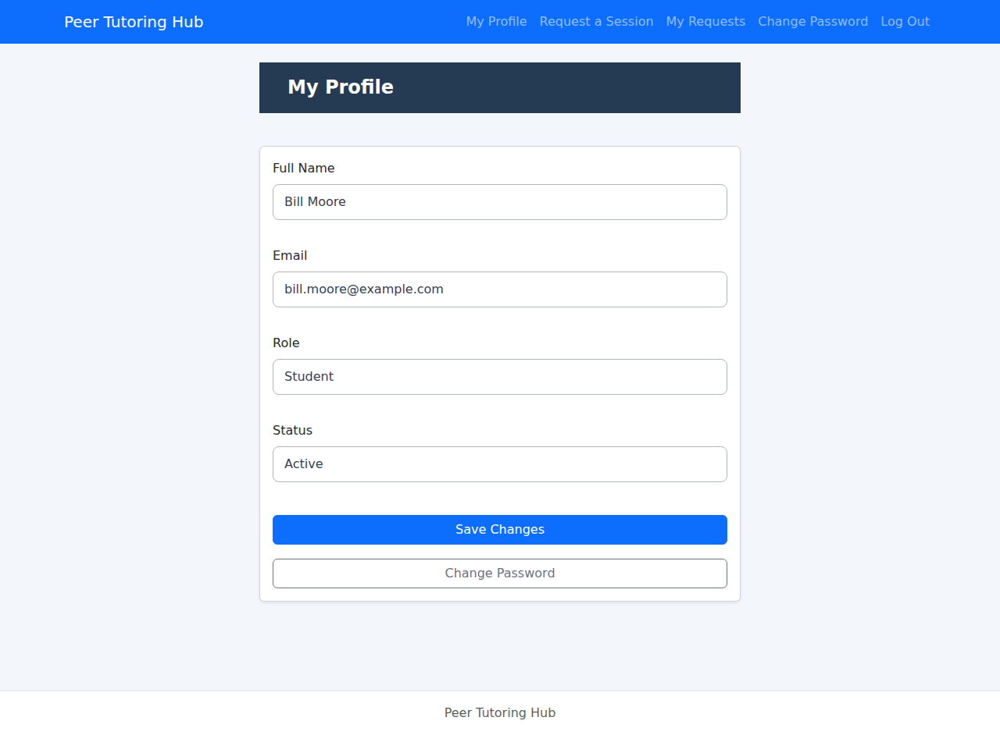

# Lab 7 Notes: Authentication and Authorization for the Peer Tutoring Hub

Repo: https://github.com/alexkinger/IS6465-LAB7  
App folder: `lab7/`  
Lab 6 repo was left alone.

Test data only. No real personal information.

---

## Part 1: Generate the Lab 7 Application

I started from Lab 6 and the Module 8 materials (UM design doc, auth handout, Skills Pack). I used AI for a first draft of the UM/auth pieces, then I reviewed the output against the design document and reading handout before keeping anything.

### Prompt used for the first draft

```
Generate code for all user management use cases UM-01 through UM-10 in the User Management Design Document.

Use the Application Builder, Test Harness Generator, and Traceability Auditor documents as implementation guidance. Follow the authentication, authorization, session management, password hashing, CSRF protection, and role based access practices in the Authentication Reading Handout.

Use lab6.zip as the existing Peer Tutoring Hub application to extend. Preserve the Lab 6 three tier architecture and update the application as needed to support user registration, login, logout, profile management, administrator access, and protected tutoring request workflows.

Return a complete Lab 7 application package with all updated and new files.
```

### Source files uploaded for that draft

1. Peer Tutoring Hub User Management Design Document
2. Application Builder
3. Test Harness Generator
4. Traceability Auditor
5. Authentication Reading Handout
6. lab6.zip

### How Lab 7 extends Lab 6

Same three-tier layout as Lab 6. Lab 7 adds `users`, links `students.user_id`, and protects the request workflow with login, roles, ownership, password hashing, sessions, and CSRF. Student and Administrator are in scope. Tutor request work is postponed.

### What I verified myself

I checked `lab7/includes/auth.php` against the reading handout. `requireLogin` uses a 1200-second idle timeout, reloads the user from SQLite, and rejects Inactive accounts. I also confirmed public registration cannot create an Administrator role. That matches the design doc. I did not treat the first AI draft as finished work. I ran the DB setup, admin create script, student/admin workflows, and tests myself.

---

## Part 2: Set Up the Database

```bash
cd lab7/database
sqlite3 tutoring.db < setup-database.sql
sqlite3 tutoring.db < upgrade-to-user-management.sql
sqlite3 tutoring.db
.tables
.quit
```

All three tables appeared:

```
students           tutoring_requests  users
```

---

## Part 3: Create an Administrator Account

```bash
php create-admin.php "Test Administrator" admin@example.com "<password-at-least-12-characters>"
```

Admin account created successfully.

- Email: `admin@example.com`
- Role: `Administrator`

---

## Part 4: Run the Application

```bash
cd ..
php -S 0.0.0.0:8000
```

URL opened: `http://127.0.0.1:8000/`

App opened. Without login, protected pages redirected to `/php/login.php`.


---

## Part 5: Test the Student Workflow

Test student: Bill Moore / `bill.moore@example.com`

| Test | What I Did | Expected Result | Actual Result | Pass or Fail |
|------|------------|-----------------|---------------|--------------|
| Register student account | Created account as Student with test data | Student account is created | Account created; redirected to login | Pass |
| Log in as student | Logged in with student email/password | Student can access protected student pages | Landed on My Profile with student nav | Pass |
| View or update profile | Opened My Profile | Profile information is displayed or saved | Name, email, Student, Active shown | Pass |
| Create tutoring request | Submitted a tutoring request | A new request is created with status Open | Request created as Open | Pass |
| Edit Open request | Edited and saved the Open request | Updated request information is displayed | Updated details shown | Pass |
| View my requests | Opened My Requests | Student sees the student’s own requests | Own request listed | Pass |
| Log out | Logged out, then hit a protected page | Session ends and login page appears | Redirected to login | Pass |



---

## Part 6: Test the Administrator Workflow

Logged in as `admin@example.com`. Opened Manage Users and All Requests. Confirmed admin can see more than one student’s account and request data. Logged out.

**What is authentication in this application?**  
Proving who the user is. Login checks email, Active status, and password hash, then starts a session.

**What is authorization in this application?**  
Deciding what that user is allowed to do. Role checks and ownership checks limit pages and records.

**How is student access different from administrator access?**  
Students only manage their own profile and requests. Admins can manage users and view all requests.

**Which functions or pages should be limited to administrators?**  
Manage Users, Update Role, Update Status, Delete User, and the all-requests view.

**What happens after logout if a user tries to visit a protected page directly?**  
`requireLogin` sends them back to the login page.


---

## Part 7: Trace Registration and Login

I traced these paths in the actual files, not from the AI summary alone.

### Student registration

| Question | Answer |
|----------|--------|
| Which file displays the Create Account form? | `lab7/php/register.php` |
| Which file receives the submitted registration form? | `lab7/php/register.php` |
| Which file or function creates and verifies the CSRF token? | `lab7/includes/auth.php` (`csrfToken`, `verifyCsrfToken`) |
| Which service validates the registration information? | `lab7/services/userService.php` (`registerUser`) |
| Where is the password hashed? | `userService.php` with `password_hash` |
| Which repository files insert user and student data? | `userPDO.php` and `studentPDO.php` |
| Which database tables receive records when a student registers? | `users` and `students` |

Browser → `register.php` → CSRF checks → user service → repositories → SQLite.

### User login

| Question | Answer |
|----------|--------|
| Which file displays the login form? | `lab7/php/login.php` |
| Which file receives the submitted login credentials? | `lab7/php/login.php` |
| Which repository retrieves a user by email address? | `userPDO.php` (`findUserByEmail`) |
| Where is the submitted password verified? | `userService.php` (`password_verify`) |
| What session actions occur after successful login? | Regenerate session ID; store `user_id`, `display_name`, `role`, `last_activity`; set CSRF token; redirect to profile |
| Why should the application regenerate the session ID after login? | Stops session fixation. The pre-login session ID should not stay valid. |
| How does the application determine whether the logged in user is a student or administrator? | From `users.role`, loaded into the session and refreshed by `requireLogin` |

Browser → `login.php` → CSRF checks → user service → user repository → SQLite.

### Why hashing belongs in the application layer

The service layer owns auth rules. Presentation should not hash passwords. The database should store the hash, not invent hashing logic. Putting `password_hash` / `password_verify` in `userService` keeps that rule in one place I can test and review.

---

## Part 8: Run the Automated Tests

```bash
php tests/validation-tests.php
php tests/user-management-tests.php
php tests/integration-tests.php
```

I did not change the provided test files.

### Validation tests: PASS

```
Valid time: PASS
Missing time: PASS
Altered value: PASS
Multiple valid topics: PASS
Missing topics: PASS
Altered topic: PASS
Minimum length: PASS
Maximum length: PASS
Too short: PASS
Too long: PASS
```

### User management tests: PASS

```
PASS UM-01 student registration creates Active Student
PASS UM-01 student profile row linked by user_id
PASS UM-01 rejects Administrator via public registration
PASS UM-01 duplicate email rejected
PASS UM-09 valid credentials authenticate
PASS UM-09 invalid password rejected
PASS Password hash does not contain plaintext password
PASS password_verify succeeds for stored hash
PASS UM-04 profile name update
PASS UM-05 new password works
PASS UM-05 old password fails
PASS Administrator account created
PASS UM-03 search returns matching accounts
PASS UM-06 role update
PASS UM-07 deactivate account
PASS UM-07 inactive user cannot log in
PASS Student can create tutoring request while authenticated
PASS UM-08 deletion blocked by related tutoring records
PASS Student request list shows own requests
PASS CSRF helper functions are available
PASS CSRF token format is 64 hex characters
All user-management checks passed
```

### Integration tests: FAIL (3)

```
PASS UC01 create and Open
PASS Lab 4 checkbox values preserved
FAIL Duplicate email reuses student
FAIL UC02 course and status filter
PASS Invalid reason rejected
FAIL Invalid submission writes nothing
PASS Edit Open request
PASS Updated reason persisted
PASS Cancel Open request
PASS Cancelled row retained
PASS Second cancellation rejected
PASS Unrelated request unchanged
PASS FK enforced
PASS UC02 empty filter result
FAILURES: 3
```

**Failed tests**

1. **Duplicate email reuses student**  
   Expects exactly 1 student row. Seed data already inserts Maria Lopez, so the count is higher even when Jordan is reused.

2. **UC02 course and status filter**  
   Expects exactly 2 Open IS 6465 requests. Seed request plus the test requests changes that count.

3. **Invalid submission writes nothing**  
   Expects exactly 2 tutoring_requests rows after the invalid attempt. Seed data already adds a request.

I left the provided tests alone, as instructed. These look like seed-count mismatches, not broken create/edit/cancel behavior.

---

## Part 9: AI Skills Pack Process

I used AI here for explanation and review, then checked the real files.

### Application Builder

**Prompt:**  
Explain how a student registration request moves from `register.php` through authentication checks, PHP services, repositories, PDO, and SQLite in the Peer Tutoring Hub application. Identify the responsibility of each file or layer.

**AI response (summary):**  
`register.php` shows the form and handles POST. `auth.php` starts the session and checks CSRF. `userService` validates input and hashes the password. `userPDO` / `studentPDO` insert into SQLite through PDO from `config/db.php`.

**What I verified:**  
The hashing claim is correct. In `lab7/services/userService.php`, `registerUser` calls `password_hash` before `insertUser`.

### Traceability Auditor

**Prompt:**  
Trace the requirement “a student can register, log in, create a tutoring request, and log out” through the presentation pages, authentication code, services, repositories, SQLite tables, and automated tests in this project.

I used the AI outline as a checklist, then filled this table from the project files and test runs:

| Requirement | Presentation Page | Authentication or Authorization | Service or Validation | Repository or SQL | Database Table | Test Evidence |
|-------------|-------------------|----------------------------------|-----------------------|-------------------|----------------|---------------|
| Student registers an account | `php/register.php` | CSRF; Student/Tutor only | `registerUser` | `insertUser`, student insert/link | `users`, `students` | UM-01 in user-management tests |
| Student logs in | `php/login.php` | CSRF; session regenerate | `authenticateUser` | `findUserByEmail` | `users` | UM-09 in user-management tests |
| Student creates a tutoring request | `request-form.php` → `process-request.php` | `requireLogin`, Student role, CSRF | `submitRequestForUser` | `insertTutoringRequest` | `students`, `tutoring_requests` | user-management + UC01 integration |
| User logs out | `php/logout.php` | `logoutSession` | session cleanup | N/A | N/A | Manual logout in Part 5 |

### Test Harness Generator

**Prompt:**  
Suggest one useful test case for authentication or authorization in the Peer Tutoring Hub application.

**AI suggestion:**  
Reject public registration when role is set to Administrator.

**My evaluation:**  
Already covered in `user-management-tests.php`. I also checked the register form only offers Student/Tutor. The suggestion is appropriate. It matches the design rule. I did not need to add a new test for it.

### Skills Pack reflection

AI helped me map the registration path and spot which files to open first. It did not replace reading the design doc, handout, or source. I still had to run the workflows, inspect the database, and confirm ownership/CSRF/role behavior myself. That check matters because AI can describe the right architecture and still miss a real boundary in the code.

---

## Part 10: Inspect the Database

```bash
sqlite3 database/tutoring.db
```

```sql
SELECT
    u.user_id,
    u.full_name,
    u.email,
    u.role,
    u.status,
    s.student_id,
    s.student_name,
    s.student_email
FROM users AS u
LEFT JOIN students AS s
    ON u.user_id = s.user_id
ORDER BY u.user_id;
```

```
1|Test Administrator|admin@example.com|Administrator|Active|||
2|Bill Moore|bill.moore@example.com|Student|Active|2|Bill Moore|bill.moore@example.com
```

**What the LEFT JOIN does:**  
Returns every user. Adds student columns when a matching `students.user_id` exists. No match means NULL student fields.

**How users connects to students:**  
`students.user_id` references `users.user_id`.

**Why account info is separate from student profile info:**  
Accounts hold login, role, and status. Student rows support tutoring requests. Keeping them apart lets admins exist without a tutoring profile and keeps password hashes out of request tables.

**Why an admin may have no students row:**  
`create-admin.php` only inserts into `users`. Admins are not tutoring students, so no student profile is required.

```
.quit
```

---

## Submission

- GitHub repo: https://github.com/alexkinger/IS6465-LAB7  
- Notes: `lab7-notes.md`
