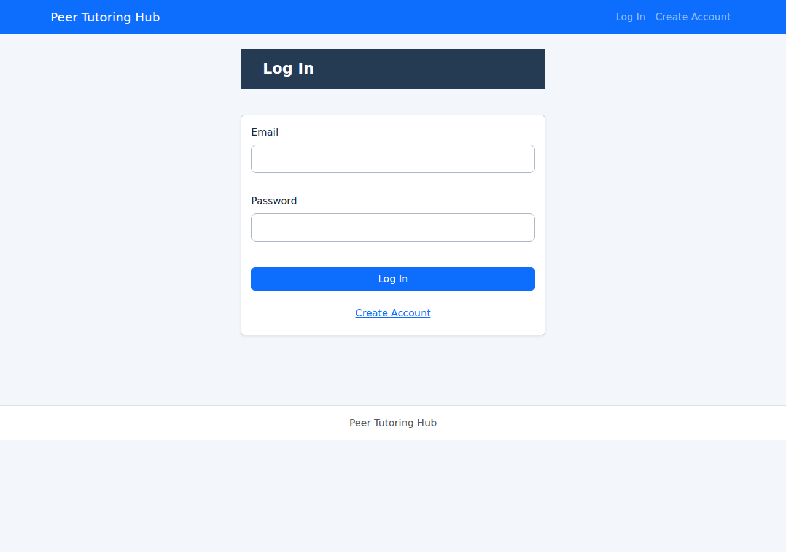
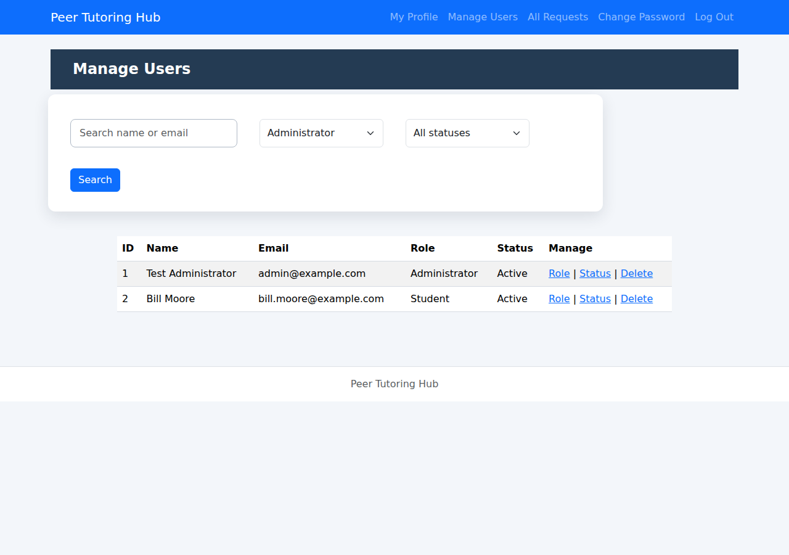

# Lab 7 Notes: Authentication and Authorization for the Peer Tutoring Hub

GitHub repository: https://github.com/alexkinger/IS6465-LAB7  

Application folder: `lab7/` (per assignment instructions). Lab 6 (`IS6465-LAB6`) was not modified.

Classroom demonstration only. Test data only. Do not enter real names, university IDs, email addresses, or passwords.

---

## Part 1: Generate the Lab 7 Application

### AI prompt used

```
Generate code for all user management use cases UM-01 through UM-10 in the User Management Design Document.

Use the Application Builder, Test Harness Generator, and Traceability Auditor documents as implementation guidance. Follow the authentication, authorization, session management, password hashing, CSRF protection, and role based access practices in the Authentication Reading Handout.

Use lab6.zip as the existing Peer Tutoring Hub application to extend. Preserve the Lab 6 three tier architecture and update the application as needed to support user registration, login, logout, profile management, administrator access, and protected tutoring request workflows.

Return a complete Lab 7 application package with all updated and new files.
```

### Uploaded source files

1. Peer Tutoring Hub User Management Design Document
2. Application Builder document
3. Test Harness Generator document
4. Traceability Auditor document
5. Authentication Reading Handout
6. lab6.zip (Lab 6 Peer Tutoring Hub application)

### How Lab 7 extends Lab 6

Lab 7 keeps the Lab 6 three-tier architecture (`php/`, `services/`, `repositories/`, `config/`, `database/`, `tests/`). It adds user accounts, login/logout, sessions, password hashing, CSRF protection, and role-based access for Student and Administrator users. Tutoring request pages are protected so students manage their own requests and administrators can review users and all requests. Tutor request workflow is postponed as stated in the lab.

### One generated file verified against the design document / reading handout

`lab7/includes/auth.php` was checked against the Authentication Reading Handout. It provides `startSecureSession`, `requireLogin` (20-minute / 1200-second idle timeout, reload user from SQLite, reject Inactive accounts), `requireRole`, CSRF helpers, and complete logout cleanup. That matches the handout’s shared session-guard pattern. Public registration in `lab7/services/userService.php` also rejects Administrator creation, which matches the User Management Design Document rule that public registration cannot grant Administrator.

---

## Part 2: Set Up the Database

Commands used (from the repository root):

```bash
cd lab7/database
sqlite3 tutoring.db < setup-database.sql
sqlite3 tutoring.db < upgrade-to-user-management.sql
```

Then:

```bash
sqlite3 tutoring.db
.tables
.quit
```

Confirmation: all three required tables appeared: `students`, `tutoring_requests`, and `users`.

Pasted `.tables` output:

```
students           tutoring_requests  users
```

---

## Part 3: Create an Administrator Account

From `lab7/database`, command structure used (actual password omitted from notes):

```bash
php create-admin.php "Test Administrator" admin@example.com "<password-at-least-12-characters>"
```

Confirmation: the script reported that the administrator account was created successfully.

- Test administrator email: `admin@example.com`
- Role assigned: `Administrator`

---

## Part 4: Run the Application

Returned to the lab7 project root and started the PHP development server exactly as instructed:

```bash
cd ..
php -S 0.0.0.0:8000
```

Browser URL opened: `http://127.0.0.1:8000/` (Codespaces: forwarded port 8000).

The application opened successfully. When first accessed without being logged in, the application redirected to the login page (`/php/login.php`).



---

## Part 5: Test the Student Workflow

Registered and tested with fictional student data (`Bill Moore`, `bill.moore@example.com`).

| Test | What I Did | Expected Result | Actual Result | Pass or Fail |
|------|------------|-----------------|---------------|--------------|
| Register student account | Opened Create Account, entered test name/email/password, chose Student, submitted | Student account is created | Redirected to login with registration confirmation; student account stored | Pass |
| Log in as student | Entered student email and password on login form | Student can access protected student pages | Redirected to My Profile; student navigation links available | Pass |
| View or update profile | Opened My Profile and reviewed name, email, role, status | Profile information is displayed or saved | Profile showed Bill Moore, bill.moore@example.com, Student, Active | Pass |
| Create tutoring request | Opened Request a Session and submitted a valid Open request | A new request is created with status Open | Request created with status Open | Pass |
| Edit Open request | Edited the Open request details and saved | Updated request information is displayed | Updated request details displayed on the request page | Pass |
| View my requests | Opened My Requests | Student sees the student’s own requests | Student request list showed the student’s own request | Pass |
| Log out | Selected Log Out, then tried a protected page | Session ends and login page appears | Redirected to login; protected page required login again | Pass |

Screenshot (student profile after successful registration/login):


Additional student evidence: `screenshots/02-student-registration-success.png`, `screenshots/04-student-tutoring-request.png`, `screenshots/05-student-request-list.png`.

---

## Part 6: Test the Administrator Workflow

Logged in with the administrator account from Part 3 (`admin@example.com`).

Completed:

1. Log in as the administrator.
2. View the user list (Manage Users).
3. View tutoring requests (All Requests).
4. Confirmed the administrator can view information beyond one student’s own account and requests (admin + student accounts; multiple requests including other student data).
5. Log out.

### Answers

**What is authentication in this application?**  
Authentication verifies who the user is. Login checks email, Active status, and the password hash, then creates a server-side session identity.

**What is authorization in this application?**  
Authorization decides what the authenticated user may do. The app uses role checks (`requireRole`) and ownership checks (students only see requests linked through `students.user_id`).

**How is student access different from administrator access?**  
Students can manage their own profile and only their own tutoring requests. Administrators can search/manage users and view all tutoring requests.

**Which functions or pages should be limited to administrators?**  
Manage Users, Update Role, Update Status, Delete User, and viewing all tutoring requests across students.

**What happens after logout if a user tries to visit a protected page directly?**  
`requireLogin` finds no valid session and redirects the browser to the login page.

Screenshot (administrator user list):



Additional admin evidence: `screenshots/07-admin-all-requests.png`.

---

## Part 7: Trace Registration and Login

### Student registration workflow

| Question | Answer |
|----------|--------|
| Which file displays the Create Account form? | `lab7/php/register.php` |
| Which file receives the submitted registration form? | `lab7/php/register.php` (POST to itself) |
| Which file or function creates and verifies the CSRF token? | `lab7/includes/auth.php` (`csrfToken`, `csrfField`, `verifyCsrfToken`) |
| Which service validates the registration information? | `lab7/services/userService.php` (`validateRegistration` / `registerUser`) |
| Where is the password hashed? | `lab7/services/userService.php` in `registerUser` using `password_hash` |
| Which repository files insert user and student data? | `lab7/repositories/userPDO.php` (`insertUser`) and `lab7/repositories/studentPDO.php` (`insertStudentWithUser` / link existing student) |
| Which database tables receive records when a student registers? | `users` and `students` |

Guide flow used: Browser → `register.php` → authentication and CSRF checks → registration controller → user service → user and student repositories → SQLite database.

### User login workflow

| Question | Answer |
|----------|--------|
| Which file displays the login form? | `lab7/php/login.php` |
| Which file receives the submitted login credentials? | `lab7/php/login.php` (POST to itself) |
| Which repository retrieves a user by email address? | `lab7/repositories/userPDO.php` (`findUserByEmail`) |
| Where is the submitted password verified? | `lab7/services/userService.php` (`authenticateUser` with `password_verify`) |
| What session actions occur after successful login? | `session_regenerate_id(true)`; store `user_id`, `display_name`, `role`, `last_activity`; create CSRF token; redirect to profile |
| Why should the application regenerate the session ID after login? | To prevent session fixation. An attacker should not keep using a session ID that existed before authentication. |
| How does the application determine whether the logged in user is a student or administrator? | From the `role` value stored in the `users` table and loaded into the session (`$_SESSION['role']`), refreshed by `requireLogin` |

Guide flow used: Browser → `login.php` → authentication and CSRF checks → login controller → user service → user repository → SQLite database.

### Why password hashing and verification belong in the application layer

Password hashing and verification should happen in the application layer because that layer owns authentication business rules. Presentation pages should collect input and display results, not decide how credentials are stored. The database should store the finished hash, not invent hashing in SQL or in a setup script. Keeping `password_hash` and `password_verify` in `userService` makes the rules reusable, testable, and easier to audit.

---

## Part 8: Run the Automated Tests

From the `lab7` project root:

```bash
php tests/validation-tests.php
php tests/user-management-tests.php
php tests/integration-tests.php
```

The provided test files were not changed. `validation-tests.php` and `integration-tests.php` match the Lab 6 starter versions. `user-management-tests.php` is the additional Lab 7 suite.

### Validation tests: PASS

```
Valid time: PASS
Missing time: PASS
Altered value: PASS
Multiple valid topics: PASS
Missing topics: PASS
Altered topic: PASS
Minimum length: PASS
Maximum length: PASS
Too short: PASS
Too long: PASS
```

### User management tests: PASS

```
PASS UM-01 student registration creates Active Student
PASS UM-01 student profile row linked by user_id
PASS UM-01 rejects Administrator via public registration
PASS UM-01 duplicate email rejected
PASS UM-09 valid credentials authenticate
PASS UM-09 invalid password rejected
PASS Password hash does not contain plaintext password
PASS password_verify succeeds for stored hash
PASS UM-04 profile name update
PASS UM-05 new password works
PASS UM-05 old password fails
PASS Administrator account created
PASS UM-03 search returns matching accounts
PASS UM-06 role update
PASS UM-07 deactivate account
PASS UM-07 inactive user cannot log in
PASS Student can create tutoring request while authenticated
PASS UM-08 deletion blocked by related tutoring records
PASS Student request list shows own requests
PASS CSRF helper functions are available
PASS CSRF token format is 64 hex characters
All user-management checks passed
```

### Integration tests: FAIL (3 failures)

Complete output:

```
PASS UC01 create and Open
PASS Lab 4 checkbox values preserved
FAIL Duplicate email reuses student
FAIL UC02 course and status filter
PASS Invalid reason rejected
FAIL Invalid submission writes nothing
PASS Edit Open request
PASS Updated reason persisted
PASS Cancel Open request
PASS Cancelled row retained
PASS Second cancellation rejected
PASS Unrelated request unchanged
PASS FK enforced
PASS UC02 empty filter result
FAILURES: 3
```

#### Failed integration tests (evaluation)

Per lab instructions, the provided test files were not modified. The three failures match the coding companion’s Lab 7 demo outcome and are left for a later testing focus.

1. **Duplicate email reuses student**  
   Checks that a second submit with the same email does not create another `students` row (`COUNT(*) === 1`).  
   Likely cause: `setup-database.sql` already seeds Maria Lopez, so the student count is higher than the test expects even when Jordan is reused correctly.

2. **UC02 course and status filter**  
   Checks that filtering Open IS 6465 requests returns exactly 2 rows.  
   Likely cause: the seeded Maria Lopez request plus the two Jordan requests changes the expected count.

3. **Invalid submission writes nothing**  
   Checks that invalid input leaves `tutoring_requests` at exactly 2 rows.  
   Likely cause: the seeded request already exists, so the total is higher than the assertion expects.

Further investigation would focus on seed data in `setup-database.sql` versus the hard-coded counts in the provided integration test. No test file changes were made.

---

## Part 9: Use the AI Skills Pack Process

### Application Builder

**Prompt:**  
Explain how a student registration request moves from `register.php` through authentication checks, PHP services, repositories, PDO, and SQLite in the Peer Tutoring Hub application. Identify the responsibility of each file or layer.

**AI response:**  
A student opens `php/register.php`, which is the presentation page for the Create Account form. On GET, `includes/auth.php` starts a secure session and creates a CSRF token for the form. On POST, `register.php` calls `verifyCsrfToken` before any account write. Valid requests call `registerUser` in `services/userService.php`. That service validates name, email, password strength, password confirmation, and allowed public roles (Student or Tutor only). It hashes the password with `password_hash` and opens a transaction. `repositories/userPDO.php` inserts the account into `users`. For Student role, `repositories/studentPDO.php` inserts or links a `students` row using `user_id`. `config/db.php` supplies the PDO connection to `database/tutoring.db`. Presentation collects and displays; the service enforces business rules and hashing; repositories own SQL; SQLite stores the records.

**Accurate statement verified in code:**  
“The password is hashed in the service layer before the repository insert.” Verified in `lab7/services/userService.php` inside `registerUser`, which calls `password_hash` and then `insertUser`.

### Traceability Auditor

**Prompt:**  
Trace the requirement “a student can register, log in, create a tutoring request, and log out” through the presentation pages, authentication code, services, repositories, SQLite tables, and automated tests in this project.

**AI response (used to build the table below):**  
The requirement maps to UM-01, UM-09, the protected UC01 request flow, and UM-10. Registration is `register.php` plus `userService` / user and student repositories / `users`+`students`. Login is `login.php` plus `authenticateUser` / `findUserByEmail` / session regenerate. Request creation is `request-form.php` and `process-request.php` with `requireLogin`, Student role, CSRF, and `submitRequestForUser`. Logout is `logout.php` calling `logoutSession`. Tests cover registration/login/request behavior in `user-management-tests.php` and request persistence in `integration-tests.php`; logout was verified manually in the student workflow.

| Requirement | Presentation Page | Authentication or Authorization | Service or Validation | Repository or SQL | Database Table | Test Evidence |
|-------------|-------------------|----------------------------------|-----------------------|-------------------|----------------|---------------|
| Student registers an account | `php/register.php` | CSRF via `auth.php`; public roles limited to Student/Tutor | `registerUser` / `validateRegistration` | `insertUser`, `insertStudentWithUser` | `users`, `students` | UM-01 cases in `tests/user-management-tests.php` |
| Student logs in | `php/login.php` | CSRF; `session_regenerate_id` after success | `authenticateUser` + `password_verify` | `findUserByEmail` | `users` | UM-09 cases in `tests/user-management-tests.php` |
| Student creates a tutoring request | `php/request-form.php` → `process-request.php` | `requireLogin`, `requireRole(Student)`, CSRF | `submitRequestForUser` / `validateSubmission` | `insertTutoringRequest`, student lookup by `user_id` | `students`, `tutoring_requests` | “Student can create tutoring request” + UC01 integration |
| User logs out | `php/logout.php` | `logoutSession` clears session data and cookie | Session cleanup in `auth.php` | N/A | N/A (session only) | Manual Part 5 logout; protected page redirects afterward |

### Test Harness Generator

**Prompt:**  
Suggest one useful test case for authentication or authorization in the Peer Tutoring Hub application. The test must relate to registration, login, logout, session protection, role based access, password validation, CSRF protection, or account status.

**AI response:**  
Suggested test: attempt public registration with role `Administrator` and assert the request is rejected and no Administrator account is created. This protects the approved design rule that public registration cannot grant Administrator privileges.

**Evaluation:**

- **Already covered?** Yes. `tests/user-management-tests.php` includes “UM-01 rejects Administrator via public registration.”
- **How to test manually or add automated coverage:** Manually, open Create Account and confirm only Student/Tutor options are offered, then attempt a forged POST with `role=Administrator` and confirm the error and no admin row. Automated coverage already exists in the user-management suite.
- **Is the AI generated test appropriate?** Yes. It matches an approved authorization boundary from the User Management Design Document and is relevant to Lab 7.

### Skills Pack reflection

The AI Skills Pack helped keep Lab 7 aligned with the existing Lab 6 three-tier layout instead of inventing a new structure. The Application Builder explanation made the registration path easier to narrate for Part 7. The Traceability Auditor table forced a file-by-file check from requirement to page, service, repository, table, and test. Developers must still verify AI generated explanations, code, and tests against the actual requirements and source code, because Skills Pack guidance can lag the week’s auth materials and generated output can miss CSRF, ownership, or schema details.

---

## Part 10: Inspect the Database

From the lab7 project root:

```bash
sqlite3 database/tutoring.db
```

Query:

```sql
SELECT
    u.user_id,
    u.full_name,
    u.email,
    u.role,
    u.status,
    s.student_id,
    s.student_name,
    s.student_email
FROM users AS u
LEFT JOIN students AS s
    ON u.user_id = s.user_id
ORDER BY u.user_id;
```

Result:

```
1|Test Administrator|admin@example.com|Administrator|Active|||
2|Bill Moore|bill.moore@example.com|Student|Active|2|Bill Moore|bill.moore@example.com
```

### Explanations

**What the LEFT JOIN does in this query:**  
It returns every row from `users` and adds matching `students` columns when a linked student profile exists. Users without a student row still appear, with NULL student fields.

**How the users table connects to the students table:**  
`students.user_id` references `users.user_id`. One user account can link to at most one student profile.

**Why the application stores account information separately from student profile information:**  
Login credentials, role, and status belong to the account (`users`). Tutoring identity and requests belong to `students` / `tutoring_requests`. Separating them lets Administrators exist without a tutoring profile and keeps password hashes out of tutoring tables.

**Why an administrator account may not have a matching row in the students table:**  
Administrators are created for management, not tutoring requests. The `create-admin.php` script inserts only into `users`, so the LEFT JOIN correctly shows NULL student columns for that account.

```
.quit
```

---

## Required submission files

1. GitHub Codespaces link for https://github.com/alexkinger/IS6465-LAB7  
2. This file: `lab7-notes.md`
